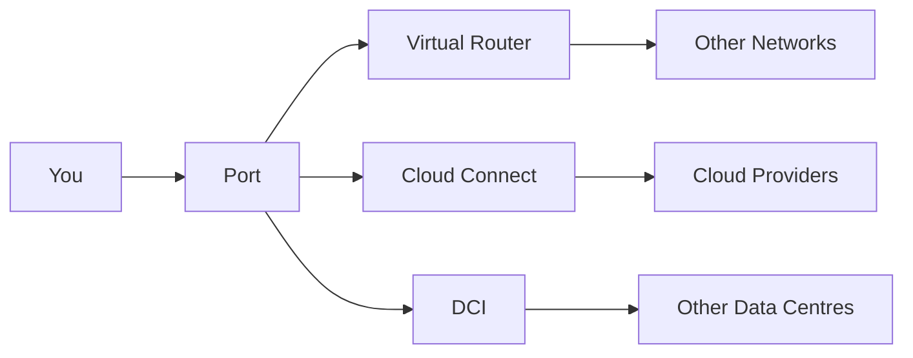

Polarin is where you provision and manage your organisation's network connectivity - ports, virtual connections, cloud interconnects, and routers - from one place, without opening a support ticket for every change.

Instead of emailing a network team and waiting on a quote, you pick a location, configure the service you need, and place the order yourself. Most services move from order to "live" in minutes rather than days.

## What Polarin Does

Polarin covers the connections most organisations need to stitch their infrastructure together:

- Physical **Ports** at data centre locations, the entry point for everything else.
- **Virtual Routers** for L3 routing between clouds, data centres, and partners.
- Direct **cloud connections** into major providers, bypassing the public internet.
- **Data Centre Interconnect (DCI)** for linking sites together at high bandwidth.

Every service is visible in one dashboard, so you can see what's live, what's pending, and what needs attention without switching between vendor portals. See [Services Offered](/get-started/services-offered) for the full breakdown.

## How It Helps

- **Self-service:** configure and order connectivity yourself instead of routing every request through a ticket queue.
- **One place to look:** ports, routers, and cloud connections all show up in the same dashboard, with real status instead of a support thread.
- **Room to grow:** scale bandwidth or add locations as your needs change, without renegotiating a contract each time.
- **Controlled access:** invite teammates and assign roles, so the right people can act without sharing one login.

<Tip>
  Not sure where to start? [Services Offered](/get-started/services-offered) breaks down each service in more detail, and [Quick Setup](/get-started/quick-setup) walks through getting your account ready end to end.
</Tip>

## How the Pieces Fit Together

A typical setup starts with a **Port** at the data centre where you need a presence. From there, you can attach a **Virtual Router** to route traffic between sites, or connect straight into a cloud provider. Ports can also be bundled into a [Link Aggregation Group](/products/port/lag) when you need more throughput or built-in redundancy.

None of these are locked together - use just a port if that's all you need, or combine several services as your network grows.

## Next Steps

- Read [Services Offered](/get-started/services-offered) for a closer look at each service category.
- Follow [Quick Setup](/get-started/quick-setup) to get your account, profile, and first service ready.
- Already set up? Jump straight to [Create a Port](/products/port/create) or [Create a Virtual Router](/products/virtual-router/create).
