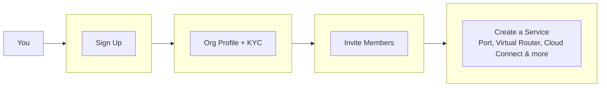

A fast path through the pages you'll need to get your account ready and your first service live. Each step links to a full guide if you want more detail.

## The Checklist

<Steps>
  <Step title="Create your account">
    Sign up, verify your email, and set a password. See [Create a Polarin Account](/get-started/create-account) for the full walkthrough.
  </Step>
  <Step title="Complete your organisation profile">
    Add your organisation's details and submit KYC documents so Polarin can verify your account. Start with [Complete Organisation Profile](/get-started/organisation/complete-profile), then check [KYC Document Requirements](/get-started/organisation/kyc-documents) for what's needed for your entity type.
  </Step>
  <Step title="Invite your team">
    Add colleagues and assign roles so more than one person can manage services. See [Invite Team Members](/settings/user-management).
  </Step>
  <Step title="Order your first service">
    Once your organisation is verified, you can provision any service - a [Port](/products/port/create) if you need a physical entry point, a [Virtual Router](/products/virtual-router/create) for routing logic, or go straight to a [Cloud Connect](/products/cloud-connect/overview) or [Data Centre Interconnect](/products/dci/compare) connection - whichever matches what you're connecting to.
  </Step>
</Steps>

<Tip>
  Not sure which service fits your use case? [Services Offered](/get-started/services-offered) breaks each one down, and [About Polarin](/get-started/about-polarin) covers the bigger picture.
</Tip>

## Next Steps

- Once your first service is ordered, track its progress from [Understanding Service Status](/service-management/service-status).
- Keep an eye on activity across your account from the [Activity Log](/settings/activity-logs/overview).
- Need help along the way? [Contact Support](/support/contact-support) is always available.
