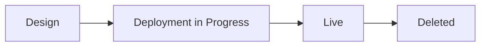

Every product on Polarin (Port, Virtual Router, Cloud Connect, DCI, Internet Exchange) shares the same six statuses, exactly as they appear in any service list's own **Advance Filter** panel: Live, Down, Design, Deployment in Progress, Configured, and Deleted. Knowing this one list means you can read the status of any service at a glance, regardless of which product it is.

The exact six statuses, straight from the product's own filter panel.

## The Status Lifecycle

- **Design** — you've started the service but haven't placed the order yet. Nothing is provisioned, and nothing is billed. A **Setup Incomplete** tag next to it just means the wizard was never finished. Open the service and pick up from Checkout.
- **Deployment in Progress** — the order is submitted and provisioning is underway. Track exactly where it's at on the service's [Track Order](/service-management/service-detail) tab. If your Organisation issues Purchase Orders, a **Purchase Order Required** step appears here too, with a deadline. Provisioning won't continue past it until PO details are added. For a Port specifically, this stage is followed by its own **Ready to Patch** step while Lightstorm arranges the physical cross-connect.
- **Configured** — specific to Virtual Router: provisioning has completed and configuration is applied, but final activation is still in progress.
- **Live** — the service is fully active. Billing starts here, not when you placed the order.
- **Down** — a previously live service has lost connectivity. Check the physical layer first (cross-connects, cabling) before assuming a Polarin-side issue.
- **Deleted** — the service has been decommissioned and moved to Archived Services.

<Tip>
  These are exactly the statuses you can filter by from any service list's **Advance Filter** panel. This is useful when you need to find, say, every service still in Deployment in Progress across your whole account.
</Tip>

## Problem States

Outside the normal lifecycle, two states signal something needs attention:

| State | Meaning |
| --- | --- |
| Down | A previously live service has lost connectivity. Check the physical layer first (cross-connects, cabling) before assuming a Polarin-side issue. |
| Setup Incomplete | Shown alongside Design when the order wizard was started but never submitted. Nothing is provisioned or billed. Open the service and finish Checkout. |

Either state unresolved after checking the basics? See [Create a Ticket](/support/create-ticket) with the service ID. It's on every service's detail page, next to its name.

## Product-Specific Detail

The lifecycle above applies everywhere, but a couple of products have extra nuance worth knowing in full:

- [Understand Port Status](/products/port/status) — the exact sequence a Port order goes through, including "Ready to Patch."
- [Understand Virtual Router Status](/products/virtual-router/status) — provisioning states specific to Virtual Router.
